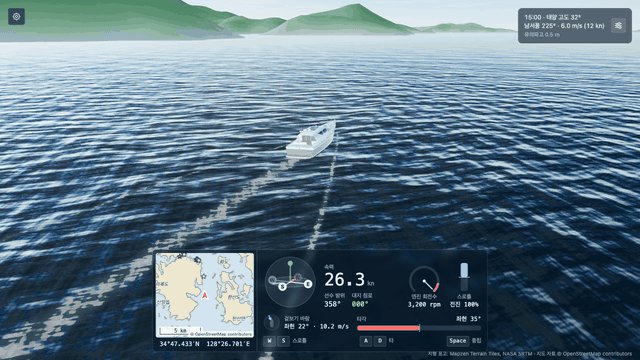
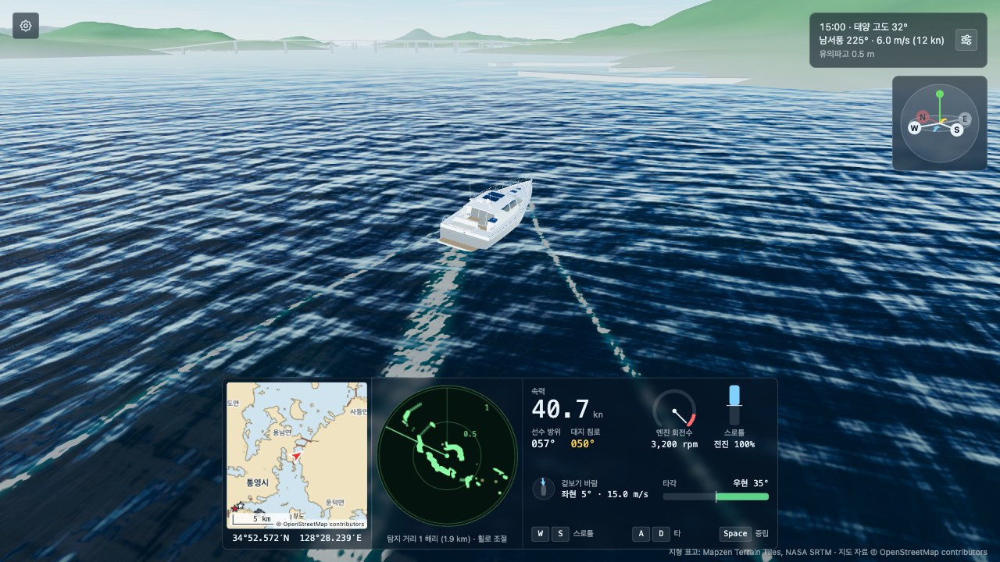

# Namhae Sail

통영과 거제 사이의 한려수도에서 실제 지형과 해도 위로 선박을 조종하는 웹 기반의 3D 항해 시뮬레이터입니다. 지형과 파도, 바람, 태양의 위치를 실제 자료와 물리 수식으로 계산합니다.

**바로 실행하기: https://namhae-sail.vercel.app/** (데스크톱의 키보드가 필요합니다)





## 주요 기능

| 기능 | 설명 |
|---|---|
| **실제 지형** | 공개 표고 자료로 배 주변 14km의 지형을 실시간으로 불러와서 표시합니다. 운영 구역은 통영~거제의 약 55×48km이며, 통영항 앞에서 출발합니다. 설정 메뉴에서 다섯 곳의 시작 위치(통영항, 한산도, 견내량, 사량도, 욕지도) 중의 하나를 골라서 바로 이동할 수 있습니다. |
| **등대와 부표** | OpenStreetMap에 등록된 운영 구역의 등대, 등표, 부표 104개를 실제 위치에 3D로 표시합니다. 부표는 파도를 따라 움직이고, 등화는 자료에 기록된 색상과 주기로 깜빡입니다. 마우스를 올리면 이름과 등화, 배에서의 방위와 거리를 표시합니다. |
| **방파제와 부두** | OpenStreetMap에 등록된 방파제와 부두 407개를 윤곽대로 3D로 세웁니다. 해도와 같은 자료를 사용하므로 두 화면이 일치합니다. |
| **다리** | 바다를 건너는 다리 39개(거가대교, 신거제대교, 통영대교 등)의 상판과 교각을 3D로 세웁니다. 다리 밑의 높이가 선박보다 낮으면 지나갈 수 없습니다. |
| **충돌** | 선체가 화면에 보이는 해안선이나 방파제, 부두, 교각, 등대, 등표에 닿으면 멈추고 경고를 표시합니다. 부표는 밀려나서 흔들립니다. 충돌한 속력에 비례해서 물보라가 튀고 화면이 흔들립니다. |
| **바람과 파도** | 풍속과 풍향을 조절하면 파도의 높이와 방향이 해양학의 스펙트럼 수식에 따라 변하고, 선체가 바람에 밀립니다. |
| **부력** | 선체 아래의 수면을 읽어서 상하 움직임과 앞뒤, 좌우의 기울기를 계산합니다. 화면에 보이는 파도와 배가 타는 파도가 일치합니다. |
| **실제 태양** | 날짜와 시각, 위치로부터 태양의 고도와 방위를 계산하고, 고도에 따라 햇빛의 색상과 세기를 변경합니다. |
| **항적** | 배가 지나간 자리에 선미의 물거품과 선수에서 갈라지는 V자 물결이 남습니다. |
| **해도와 계기판** | OpenLayers로 그린 해도에 해안선과 지명, 시가지, 방파제와 부두, 다리, 해상 표지, 배의 위치와 항적을 표시하고, 속력과 선수 방위, 대지 침로, 엔진 회전수, 스로틀, 타각, 겉보기 바람을 계기로 표시합니다. |
| **레이더** | 회전하는 안테나의 방향으로 광선을 쏘아서 주변의 해안선과 방파제, 다리, 등대와 부표를 탐지합니다. 섬의 뒤쪽은 전파가 닿지 않아서 표시되지 않고, 주사선이 지나간 자리만 갱신되며 잔상이 서서히 흐려집니다. 레이더 위에서 휠을 돌리면 탐지 거리가 0.25해리에서 4해리까지 바뀝니다. |
| **선박의 교체** | 기본 선박은 15m급 요트이며, 180m급 여객선의 사양도 함께 정의되어 있습니다. `main.ts`의 상수 하나를 바꾸면 모델과 조종 특성, 카메라의 거리, 항적의 크기가 함께 전환됩니다. |

## 실행 방법

Node.js 24와 pnpm 12에서 개발하고 확인했습니다.

```bash
pnpm install
pnpm dev        # http://localhost:5190
pnpm test       # 단위 테스트
pnpm typecheck  # 타입 검사
pnpm build      # 배포용 빌드
```

지형의 표고 자료는 실행 중에 외부 서버에서 받아 오므로 인터넷 연결이 필요합니다. 연결이 없으면 3D 화면에 지형 없이 바다만 표시됩니다. 해도는 저장소에 포함된 자료로 그리므로 연결이 없어도 표시됩니다.

## 조작 방법

| 입력 | 동작 |
|---|---|
| `W` / `S` | 스로틀 증가 / 감소. 레버처럼 놓은 위치에 유지되며, 0% 아래로 내리면 후진합니다. |
| `A` / `D` | 좌현 / 우현 타. 키를 놓으면 중앙으로 복귀합니다. |
| `Space` | 스로틀 중립 |
| `C` | 시점 초기화 |
| 드래그 / 휠 | 시점 회전 / 카메라 거리 |

오른쪽 위의 버튼으로 시각과 풍속, 풍향을 조절할 수 있고, 왼쪽 위의 설정 메뉴에서 조작키의 전체 목록을 확인하거나 시작 위치를 골라서 이동할 수 있습니다.

### 관찰 모드

구역의 여러 곳을 배를 몰고 가지 않고 둘러볼 수 있는 개발용 기능입니다. `pnpm dev`로 실행한 로컬의 개발 서버에서만 동작하며, 배포용 빌드에는 포함되지 않습니다.

| 입력 | 동작 |
|---|---|
| `F` | 관찰 모드를 켜고 끕니다. 켜져 있는 동안에는 배의 시간이 멈춥니다. |
| `W` `A` `S` `D` | 카메라가 바라보는 지점을 옮깁니다. `Shift`를 함께 누르면 빠르게 움직입니다. |
| 드래그 / 휠 | 시점 회전 / 카메라 거리 (최대 9km) |
| `T` | 배를 지금 보고 있는 위치로 옮깁니다. 육지나 구조물 위로는 옮기지 않습니다. |

설정 메뉴의 "개발 도구"에서 시, 읍면, 섬의 이름을 골라서 그 장소로 바로 이동할 수 있습니다. 주소에 `?lat=34.76&lon=128.477&observe`와 같이 적으면 그 좌표를 관찰 모드로 바라보면서 시작합니다.

## 기술 스택

| 기술 | 선택한 이유 |
|---|---|
| **TypeScript** | 좌표계와 단위가 여러 모듈에 걸쳐서 사용되므로, 타입으로 인터페이스를 고정했습니다. |
| **Three.js (WebGL2)** | 씬 그래프와 glTF 불러오기, PBR 머티리얼은 라이브러리에 맡기고, 수면과 같이 직접 제어해야 하는 부분만 GLSL 셰이더로 작성했습니다. |
| **Vite** | 셰이더와 물리 수치를 변경할 때마다 즉시 화면에서 확인하기 위해서 사용했습니다. |
| **OpenLayers** | 해도를 그립니다. 외부의 지도 타일 서버를 조회하지 않고, 미리 가공한 해안선과 해상 표지를 벡터 레이어로 표시합니다. |
| **Vitest** | 좌표 변환과 태양의 위치처럼 실제 값과 대조할 수 있는 계산을 검증합니다. |

## 구조

```
src/
  core/         렌더러, 고정 간격의 루프, 키보드 입력
  geo/          경위도와 월드 좌표, 지도 타일 좌표의 상호 변환
  environment/  바람의 상태, 태양의 위치와 햇빛의 색상
  ocean/        파도의 목록과 수면 높이 계산, 수면의 셰이더, 항적
  ship/         선박의 사양, 운동 모델, 부력, 추적 카메라
  world/        표고 타일의 해석, 지형 메시의 생성과 스트리밍, 등대와 부표
  ui/           지도, 계기판, 나침반, 환경 패널, 설정 메뉴
scripts/        요트 모델을 생성하는 스크립트, 해안선과 지명, 해상 표지 자료를 내려받는 스크립트
```

한 프레임은 다음의 순서로 처리됩니다.

```
입력 ─▶ 물리 (1/60초 고정 간격)
         ├ 운동 모델: 추력, 저항, 타, 풍압
         └ 육지 충돌 판정
       ─▶ 렌더링 (화면의 주사율)
         ├ 바람 → 파도의 목록 갱신
         ├ 파도 → 선체의 부력 계산
         ├ 지형 타일의 불러오기와 해제
         ├ 항적 지도 그리기
         ├ 태양 → 조명, 하늘, 연무
         └ 장면 그리기, 표시 장치 갱신
```

좌표 규약은 프로젝트 전체에서 동일합니다. 길이의 단위는 미터이고, 월드의 +X는 동쪽, +Y는 위쪽, -Z는 북쪽이며, 방위는 북쪽을 0으로 하는 시계 방향의 각도입니다.

## 구현 과정에서의 기술적 결정

### 1. 지도의 좌표와 월드의 좌표를 연결하는 방법

**문제**: 지도 타일은 웹 메르카토르 도법을 사용하는데, 이 도법은 위도가 높아질수록 거리를 늘려서 표현합니다. 물리 계산에는 실제 미터 단위가 필요합니다.

**결정**: 메르카토르 좌표에 기준 위도의 cos 값을 곱해서 월드 좌표로 사용했습니다. 이 방식에서는 타일이 월드에서도 축에 정렬된 정사각형으로 유지되므로, 타일을 배치하는 계산이 단순해집니다.

**검증에서 발견한 문제**: 처음에는 기준 위도를 시작 지점의 위도로 설정했는데, 테스트에서 맵의 남쪽 끝(북위 33°)의 거리 오차가 2.1%로 측정되었습니다. 기준 위도를 맵 범위의 가운데인 34.25°로 분리해서, 남해 전체에서 오차가 2% 안에 들어오도록 수정했습니다.

### 2. 화면의 파도와 물리의 파도를 일치시키는 방법

**문제**: 수면은 GPU의 셰이더에서 정점을 이동시켜서 그리는데, 선체의 부력은 CPU에서 계산해야 합니다. 두 계산이 어긋나면 배가 수면에 잠기거나 떠 보입니다.

**결정**: 파도의 목록을 TypeScript에서 한 번만 정의하고, 셰이더에는 uniform으로 전달하며, CPU에서는 같은 목록으로 수면의 높이를 계산합니다. Gerstner 파도는 수면의 점을 수평으로도 이동시키기 때문에, CPU에서는 목표 지점에 도달하는 원래의 위치를 반복 계산으로 먼저 찾습니다.

선체의 움직임은 수선면의 21개 지점에서 수면의 높이를 읽고, 그 높이에 평면을 맞춰서 구합니다. 평면의 평균 높이가 상하 움직임이 되고, 두 방향의 기울기가 종동요와 횡동요가 됩니다.

### 3. 육지 충돌의 판정 기준

**문제**: 처음에는 원본 표고 자료를 기준으로 육지를 판정했는데, 배가 화면에 보이는 해안선보다 약 80m 앞에서 멈췄습니다. 화면의 지형은 62m 간격의 정점을 이어서 그리기 때문에, 31m 해상도의 원본 자료와 해안선의 위치가 달랐습니다.

**결정**: 화면에 그려진 메시의 정점 높이를 보간해서 판정하도록 변경했습니다. 자료의 정확도보다 "보이는 것과 판정이 일치하는 것"이 조종하는 사람에게 더 중요하다고 판단했습니다.

## 검증

단위 테스트는 실제 값과 대조할 수 있는 계산을 대상으로 작성했습니다.

| 대상 | 검증 내용 |
|---|---|
| 좌표 변환 | 원점의 대응, 방위의 부호, 남해 범위에서의 거리 오차(2% 이내), 왕복 변환, 알려진 타일 번호와의 일치 |
| 태양의 위치 | 부산의 10월 12일 남중 고도(약 47.5°)와 방위, 일출과 일몰 시각의 고도, 하지와 동지의 차이 |
| 햇빛의 색상 | 고도가 낮을수록 붉고 약해지는지, 수평선 아래에서 사라지는지 |

화면의 동작은 브라우저에서 실행해서 확인했습니다. 가속과 선회의 수치, 풍압에 의한 표류 속력, 육지에서 멈추는 위치를 화면의 계기와 대조했습니다.

## 한계

- **건물은 3D로 표시되지 않습니다.**
- **구조물의 높이는 추정값입니다.** 방파제와 부두, 다리의 높이와 교각의 위치는 자료에 없어서, 종류와 형식에 따라 정한 값을 사용합니다. 실제 다리의 형태와 다릅니다.
- **수심을 반영하지 않습니다.** 수면보다 낮은 곳은 모두 항해할 수 있는 바다로 취급합니다.
- **수면에 그림자가 표시되지 않습니다.** 그림자는 선체에만 표시됩니다.
- **조종 특성은 과장되어 있습니다.** 실제 선박의 수치를 그대로 적용하면 조작이 지나치게 느려서, 가속과 선회를 실제보다 빠르게 조정했습니다.
- **해가 진 뒤의 표현이 없습니다.** 달빛과 항해등의 점등은 구현하지 않았습니다.
- **조류를 반영하지 않습니다.**

## 자료의 출처와 라이선스

이 저장소의 코드는 [MIT 라이선스](LICENSE)를 따릅니다. 저장소에 포함된 아래의 자료는 각각의 라이선스를 따르며, MIT 라이선스의 적용 대상이 아닙니다. 특히 `public/data/`의 파일은 OpenStreetMap의 자료를 가공한 것이므로 ODbL을 따릅니다.

| 자료 | 출처 | 라이선스 |
|---|---|---|
| 해안선, 지명, 방파제, 다리, 시가지, 해상 표지 | © [OpenStreetMap](https://www.openstreetmap.org/copyright) contributors, Overpass API로 추출해서 저장소에 포함 | ODbL |
| 표고 | [Mapzen Terrain Tiles](https://registry.opendata.aws/terrain-tiles/) (AWS Open Data), 육지는 NASA SRTM 기반 | 구성 자료별 라이선스 |
| 여객선 모델 | [Kenney Watercraft Kit](https://kenney.nl/) | CC0 |
| 요트 모델 | `scripts/build-yacht.mjs`로 직접 생성 | MIT (이 저장소의 코드와 동일) |
