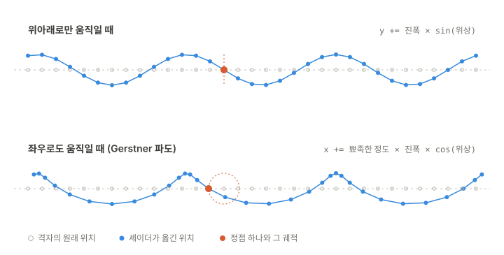

# Namhae Sail

통영과 거제 사이의 한려수도에서 실제 지형과 해도 위로 선박을 조종하는 웹 기반의 3D 항해 시뮬레이터입니다. 지형과 파도, 바람, 태양의 위치를 실제 자료와 물리 수식으로 계산하고, 거친 바다에서는 파도를 받는 방향과 속력에 따라 선체가 기울거나 뒤집힙니다.

**바로 실행하기: https://namhae-sail.vercel.app/** (데스크톱의 키보드가 필요합니다)


## 주요 기능

| 기능 | 설명 |
|---|---|
| **실제 지형** | 공개 표고 자료로 배 주변 14km의 지형을 실시간으로 불러와서 표시합니다. 운영 구역은 통영~거제의 약 55×48km이며, 통영항 앞에서 출발합니다. 왼쪽 위의 "시작 위치" 메뉴에서 다섯 곳의 시작 위치(통영항, 한산도, 견내량, 사량도, 욕지도) 중의 하나를 골라서 바로 이동할 수 있습니다. |
| **등대와 부표** | OpenStreetMap에 등록된 운영 구역의 등대, 등표, 부표 104개를 실제 위치에 3D로 표시합니다. 부표는 파도를 따라 움직이고, 등화는 자료에 기록된 색상과 주기로 깜빡입니다. 마우스를 올리면 이름과 등화, 배에서의 방위와 거리를 표시합니다. |
| **방파제와 부두** | OpenStreetMap에 등록된 방파제와 부두 407개를 윤곽대로 3D로 세웁니다. 해도와 같은 자료를 사용하므로 두 화면이 일치합니다. |
| **다리** | 바다를 건너는 다리 39개(거가대교, 신거제대교, 통영대교 등)의 상판과 교각을 3D로 세웁니다. 다리 밑의 높이가 선박보다 낮으면 지나갈 수 없습니다. |
| **충돌** | 선체가 화면에 보이는 해안선이나 방파제, 부두, 교각, 등대, 등표에 닿으면 멈추고 경고를 표시합니다. 부표는 밀려나서 흔들립니다. 충돌한 속력에 비례해서 물보라가 튀고 화면이 흔들립니다. |
| **바람과 파도** | 파도의 높이는 풍속과, 바람이 육지에 막히지 않고 불어온 거리(취주 거리)로 정합니다. 같은 바람이어도 섬의 뒤쪽은 열린 바다보다 잔잔합니다. 먼바다에서 밀려오는 너울을 따로 더하며, 큰 파도가 몇 개씩 무리를 지어 지나갑니다. 풍향은 접속할 때마다 무작위로 정해집니다. |
| **파도의 세기** | 잔잔함부터 폭풍까지 다섯 단계 가운데에서 고릅니다. 풍속 2~35m/s와 너울 0~3.8m를 조합한 15가지 환경을 세 가지씩 묶은 것이며, 한 단계 안에서도 바다가 잠잠해졌다가 거칠어지기를 반복합니다. |
| **부력과 횡동요** | 선체 아래의 수면을 읽어서 상하 움직임과 앞뒤 기울기를 계산합니다. 좌우 기울기는 고유 주기를 가진 진동으로 계산하므로, 파도를 옆에서 받으면 크게 흔들리고 선수로 받으면 거의 흔들리지 않습니다. 옆바람과 선회도 선체를 기울입니다. |
| **전복** | 선체를 일으켜 세우는 힘은 기울기가 커지면 줄어들다가 약 65°에서 사라집니다. 가파른 마루가 선체의 옆면을 때리면 그 너머로 넘어가서 뒤집힐 수 있고, 빠르게 달릴수록 충격이 커집니다. 뒤집힌 배는 엔진이 멈추며, `R` 키로 마지막에 배를 놓았던 곳에서 다시 시작합니다. |
| **부서지는 마루** | 선체를 넘어뜨릴 만큼 가파른 마루를 수면에 흰 물거품으로 표시합니다. 물리 계산과 같은 기준을 사용하므로, 화면에서 희게 부서지는 곳이 피해야 할 곳입니다. 풍속 13m/s 부근부터는 바람에 날리는 물보라가 수면에 줄을 긋습니다. |
| **실제 태양** | 날짜와 시각, 위치로부터 태양의 고도와 방위를 계산하고, 고도에 따라 햇빛의 색상과 세기를 변경합니다. |
| **항적** | 배가 지나간 자리에 선미의 물거품과 선수에서 갈라지는 V자 물결이 남습니다. |
| **해도와 계기판** | OpenLayers로 그린 해도에 해안선과 지명, 시가지, 방파제와 부두, 다리, 해상 표지, 배의 위치와 항적을 표시하고, 속력과 선수 방위, 대지 침로, 엔진 회전수, 스로틀, 타각, 겉보기 바람을 계기로 표시합니다. 경사계는 선체의 좌우 기울기를, 파도 방향 계기는 풍랑과 너울이 선수를 기준으로 어느 쪽에서 오는지를 보여 주며, 파도를 옆으로 받는 위험한 자세를 붉은색으로 경고합니다. |
| **레이더** | 회전하는 안테나의 방향으로 광선을 쏘아서 주변의 해안선과 방파제, 다리, 등대와 부표를 탐지합니다. 섬의 뒤쪽은 전파가 닿지 않아서 표시되지 않고, 주사선이 지나간 자리만 갱신되며 잔상이 서서히 흐려집니다. 레이더 위에서 휠을 돌리면 탐지 거리가 0.25해리에서 4해리까지 바뀝니다. |
| **해상도 조절** | 프레임이 느린 상태가 이어지면 장면을 그리는 해상도를 한 단계씩 낮추고, 여유가 생기면 다시 올립니다. 창의 크기와 GPU의 성능이 달라도 끊기지 않게 합니다. |
| **선박의 교체** | 기본 선박은 15m급 요트이며, 180m급 여객선의 사양도 함께 정의되어 있습니다. `main.ts`의 상수 하나를 바꾸면 모델과 조종 특성, 카메라의 거리, 항적의 크기가 함께 전환됩니다. |

## 실행 방법

Node.js 24와 pnpm 12에서 개발하고 확인했습니다.

```bash
pnpm install
pnpm dev        # http://localhost:5190
pnpm test       # 단위 테스트
pnpm typecheck  # 타입 검사
pnpm build      # 배포용 빌드
```

지형의 표고 자료는 실행 중에 외부 서버에서 받아 오므로 인터넷 연결이 필요합니다. 연결이 없으면 3D 화면에 지형 없이 바다만 표시됩니다. 해도는 저장소에 포함된 자료로 그리므로 연결이 없어도 표시됩니다.

## 조작 방법

| 입력 | 동작 |
|---|---|
| `W` / `S` | 스로틀 증가 / 감소. 레버처럼 놓은 위치에 유지되며, 0% 아래로 내리면 후진합니다. |
| `A` / `D` | 좌현 / 우현 타. 키를 놓으면 중앙으로 복귀합니다. |
| `Space` | 스로틀 중립 |
| `C` | 시점 초기화 |
| `R` | 전복된 뒤에 다시 시작 |
| 드래그 / 휠 | 시점 회전 / 카메라 거리 |

오른쪽 위의 패널에서 파도의 세기를 고를 수 있고, 왼쪽 위의 메뉴는 역할별로 나뉘어 있습니다. "시작 위치"에서 다른 곳으로 바로 이동하고, "도움말"에서 조작키의 전체 목록을 확인합니다.

거친 바다에서는 파도 방향 계기의 화살표가 붉은 구간에 들어가지 않도록 선수를 돌리고, 흰 물거품이 이는 마루 앞에서는 속력을 줄입니다. 기울어지는 쪽의 반대로 타를 쓰면 선체가 일어섭니다.

### 개발 도구

`pnpm dev`로 실행한 로컬의 개발 서버에서만 동작하며, 배포용 빌드에는 포함되지 않습니다.

**관찰 모드**는 구역의 여러 곳을 배를 몰고 가지 않고 둘러보는 기능입니다.

| 입력 | 동작 |
|---|---|
| `F` | 관찰 모드를 켜고 끕니다. 켜져 있는 동안에는 배의 시간이 멈춥니다. |
| `W` `A` `S` `D` | 카메라가 바라보는 지점을 옮깁니다. `Shift`를 함께 누르면 빠르게 움직입니다. |
| 드래그 / 휠 | 시점 회전 / 카메라 거리 (최대 9km) |
| `T` | 배를 지금 보고 있는 위치로 옮깁니다. 육지나 구조물 위로는 옮기지 않습니다. |

"개발 도구" 메뉴에서 시, 읍면, 섬의 이름을 골라서 그 장소로 바로 이동할 수 있습니다. 주소에 `?lat=34.76&lon=128.477&observe`와 같이 적으면 그 좌표를 관찰 모드로 바라보면서 시작합니다.

**날씨의 직접 조절**: 오른쪽 위의 패널에 시각, 풍속, 풍향, 너울의 높이와 방향을 하나씩 바꾸는 막대가 추가됩니다. 풍속이나 너울을 직접 바꾸면, 파도의 세기를 다시 고를 때까지 날씨가 저절로 변하지 않습니다.

**장면의 조사**: 브라우저의 콘솔에서 `window.__namhae`로 렌더러와 장면, 선박의 객체를 꺼내 볼 수 있습니다. 성능을 측정하는 스크립트가 이것으로 장면의 요소를 하나씩 끄면서 비용을 잽니다.

## 기술 스택

| 기술 | 선택한 이유 |
|---|---|
| **TypeScript** | 좌표계와 단위가 여러 모듈에 걸쳐서 사용되므로, 타입으로 인터페이스를 고정했습니다. |
| **Three.js (WebGL2)** | 씬 그래프와 glTF 불러오기, PBR 머티리얼은 라이브러리에 맡기고, 수면과 같이 직접 제어해야 하는 부분만 GLSL 셰이더로 작성했습니다. |
| **Vite** | 셰이더와 물리 수치를 변경할 때마다 즉시 화면에서 확인하기 위해서 사용했습니다. |
| **OpenLayers** | 해도를 그립니다. 외부의 지도 타일 서버를 조회하지 않고, 미리 가공한 해안선과 해상 표지를 벡터 레이어로 표시합니다. |
| **Vitest** | 좌표 변환과 태양의 위치처럼 실제 값과 대조할 수 있는 계산을 검증합니다. |

## 구조

```
src/
  main.ts       모듈을 만들어서 서로 연결하고, 한 프레임의 처리 순서를 정합니다
  core/         렌더러, 해상도 조절, 고정 간격의 루프, 키보드 입력, 관찰 모드
  geo/          경위도와 월드 좌표의 변환, 운영 구역, 단위의 변환과 표기
  environment/  바람과 너울, 파도의 세기, 태양의 위치와 햇빛의 색상
  ocean/        파도의 스펙트럼, 푸리에 변환으로 만드는 수면, 수면 높이 계산, 수면의 셰이더, 항적
  ship/         선박의 사양, 운동 모델, 횡동요, 선체가 파도와 바람에서 받는 힘, 추적 카메라
  world/        지형 타일, 육지 마스크, 취주 거리, 방파제와 부두, 다리, 등대와 부표, 공간 색인
  sim/          선박과 장애물의 충돌 판정, 전복과 부서지는 파도의 연출
  ui/           지도, 레이더, 계기판과 원형 계기, 나침반, 환경 패널, 역할별 메뉴, 시작 화면
  dev/          개발 서버에서만 사용하는 시작 조건
scripts/        요트 모델을 생성하는 스크립트, 해안선과 지명, 해상 표지 자료를 내려받는 스크립트
  lib/          스크립트들이 함께 사용하는 Overpass 요청, 도형 계산, 운영 구역
```

의존의 방향은 한쪽으로만 흐릅니다. `geo`와 `core`는 다른 폴더를 참조하지 않고, `world`와 `ship`은 서로를 참조하지 않으며, 둘을 함께 다루는 충돌 판정은 `sim`에, 전체를 연결하는 일은 `main.ts`에 둡니다.

한 프레임은 다음의 순서로 처리됩니다.

```
입력 ─▶ 물리 (1/60초 고정 간격)
         ├ 운동 모델: 추력, 저항, 타, 풍압
         └ 충돌 판정: 구역의 경계, 육지, 교각, 다리 밑의 높이, 방파제와 부두, 해상 표지
       ─▶ 렌더링 (화면의 주사율)
         ├ 프레임 시간 → 그리는 해상도 조절
         ├ 날씨: 고른 단계 안에서 풍속과 너울을 변화, 취주 거리 측정
         ├ 바람과 너울 → 파도의 목록 갱신
         ├ 파도와 바람 → 선체의 상하 움직임과 기울기, 횡동요, 전복 판정
         ├ 지형 타일의 불러오기와 해제
         ├ 항적 지도 그리기
         ├ 태양 → 조명, 하늘, 연무
         └ 장면 그리기, 표시 장치 갱신
```

좌표 규약은 프로젝트 전체에서 동일합니다. 길이의 단위는 미터이고, 월드의 +X는 동쪽, +Y는 위쪽, -Z는 북쪽이며, 방위는 북쪽을 0으로 하는 시계 방향의 각도입니다.

## 구현 과정에서의 기술적 결정

### 1. 지도의 좌표와 월드의 좌표를 연결하는 방법

**문제**: 지도 타일은 웹 메르카토르 도법을 사용하는데, 이 도법은 위도가 높아질수록 거리를 늘려서 표현합니다. 물리 계산에는 실제 미터 단위가 필요합니다.

**결정**: 메르카토르 좌표에 기준 위도의 cos 값을 곱해서 월드 좌표로 사용했습니다. 이 방식에서는 타일이 월드에서도 축에 정렬된 정사각형으로 유지되므로, 타일을 배치하는 계산이 단순해집니다.

**검증에서 발견한 문제**: 처음에는 기준 위도를 시작 지점의 위도로 설정했는데, 테스트에서 맵의 남쪽 끝(북위 33°)의 거리 오차가 2.1%로 측정되었습니다. 기준 위도를 맵 범위의 가운데인 34.25°로 분리해서, 남해 전체에서 오차가 2% 안에 들어오도록 수정했습니다.

### 2. 화면의 파도와 물리의 파도를 일치시키는 방법

**문제**: 수면은 GPU의 셰이더에서 정점을 이동시켜서 그리는데, 선체의 부력은 CPU에서 계산해야 합니다. 두 계산이 어긋나면 배가 수면에 잠기거나 떠 보입니다.

**결정**: 수면은 방향과 파장이 조금씩 다른 파도 수만 개의 합입니다. GPU는 이 합을 푸리에 변환(FFT)으로 한꺼번에 계산해서 텍스처에 담고, 수면의 셰이더가 그 텍스처를 읽어서 정점을 옮깁니다. 선체가 느낄 만큼 긴 파도(파장 13m 이상)는 약 2,900개이므로, CPU는 같은 난수와 같은 수식으로 이 파도들을 직접 더해서 선체 아래의 수면을 구합니다. GPU에서 값을 읽어 오지 않으므로 지연이 없고, 기기와 무관하게 같은 결과가 나와서 타임어택에서 같은 바다가 재현됩니다.

처음에는 Gerstner 파도 12개를 셰이더와 CPU가 각자 더하는 방식이었습니다. 계산은 가벼웠지만 같은 줄무늬가 일정한 간격으로 지나가는 것이 눈에 띄어서, 스펙트럼 전체를 푸리에 변환으로 만드는 방식으로 바꿨습니다. 수면은 파장의 범위를 나눠서 맡는 세 층(256×256칸)으로 구성되며, 가장 큰 층만 선체에 영향을 줍니다. 수면의 점은 수평으로도 이동하기 때문에, CPU에서는 목표 지점에 도달하는 원래의 위치를 반복 계산으로 먼저 찾습니다.

**검증**: GPU의 텍스처에서 읽은 값과 CPU가 계산한 값을 221개 지점에서 비교했습니다. 높이의 표준편차가 0.37m인 수면에서 두 값의 차이는 0.2mm였습니다. 이 비교에서 텍스처 좌표가 반 칸 어긋나 있던 것을 발견해서 고쳤습니다. 수면을 바꾸면서 전복의 빈도가 달라지지 않도록, 바꾸기 전과 후에 같은 조건(파도 세기와 받는 방향, 속력)으로 10분씩 모의 실험을 해서 부서지는 마루의 기준값을 다시 맞췄습니다.



위의 그림은 파도 하나가 정점을 옮기는 원리를 보여 줍니다. 수면은 평평한 격자이고, 셰이더가 격자의 점을 매 프레임 옮겨서 파도의 형태를 만듭니다. 위아래로만 옮기면 둥근 사인파가 되고, 좌우로도 옮기면 점들이 마루로 모여서 마루는 뾰족하고 골은 넓은 실제 파도의 형태가 됩니다. 점 하나는 제자리에서 원을 그릴 뿐이고, 앞으로 나아가는 것은 파도의 형태입니다. 이 그림은 `scripts/build-wave-diagram.mjs`로 생성합니다.

선체의 움직임은 수선면의 21개 지점에서 수면의 높이를 읽고, 그 높이에 평면을 맞춰서 구합니다. 평면의 평균 높이가 상하 움직임이, 앞뒤 기울기가 종동요가 됩니다. 좌우 기울기는 선체에 그대로 적용하지 않고 횡동요를 일으키는 힘으로 사용합니다. 횡동요를 고유 주기와 감쇠를 가진 진동으로 따로 계산해야, 파도를 받는 방향에 따라 흔들림이 달라지고 한계를 넘으면 뒤집히기 때문입니다.

같은 원칙을 위험한 파도의 표시에도 적용했습니다. 선체를 넘어뜨리는 마루는 물리 계산에서 마루의 가파름으로 판정하는데, 수면의 셰이더도 같은 상수로 흰 물거품을 그립니다. 기준이 하나이므로, 화면에서 부서지는 마루와 선체를 때리는 마루가 어긋나지 않습니다.

### 3. 육지 충돌의 판정 기준

**문제**: 처음에는 원본 표고 자료를 기준으로 육지를 판정했는데, 배가 화면에 보이는 해안선보다 약 80m 앞에서 멈췄습니다. 화면의 지형은 62m 간격의 정점을 이어서 그리기 때문에, 31m 해상도의 원본 자료와 해안선의 위치가 달랐습니다.

**결정**: 화면에 그려진 메시의 정점 높이를 보간해서 판정하도록 변경했습니다. 자료의 정확도보다 "보이는 것과 판정이 일치하는 것"이 조종하는 사람에게 더 중요하다고 판단했습니다.

### 4. 느려진 원인을 추측하지 않고 측정하기

**문제**: 파도와 전복의 계산을 추가한 뒤에 화면이 끊기기 시작했습니다. 추가한 것이 대부분 CPU에서 도는 물리 계산이었으므로, 그 계산이 원인일 것으로 예상했습니다.

**측정**: 프로파일러로 확인하니 주 스레드는 프레임당 3.5ms만 쓰고 87%가 쉬고 있었고, 추가한 계산은 시간을 많이 쓰는 함수의 상위 20개에도 없었습니다. GPU는 장면을 그린 직후에 픽셀 하나를 읽어서 한 프레임을 끝내는 데 걸리는 시간을 쟀는데, 1728×1117 크기의 창(화면 배율 2)에서 약 13ms였습니다. 60프레임의 한도인 16.7ms에 가까워서 여유가 거의 없었던 것입니다. 장면의 요소를 하나씩 끄면서 다시 재 보니, 가장 큰 비용은 수면이나 지형이 아니라 다중 표본 안티에일리어싱(MSAA)이었고 그 시간의 3분의 1을 차지했습니다.

**결정**: 화면 배율이 2 이상이면 MSAA를 끕니다. 픽셀이 촘촘한 화면에서는 계단 현상이 거의 보이지 않는데, 표본을 네 배로 저장하고 합치는 비용은 픽셀의 수만큼 커지기 때문입니다. 그리고 창의 크기와 GPU의 성능은 기기마다 다르므로, 프레임 시간을 보고 그리는 해상도를 조절하는 장치를 두었습니다. 느린 상태가 2초 이어지면 한 단계 낮추고, 여유가 8초 이어지면 다시 올리며, 올렸다가 곧 느려지면 다음에는 두 배로 기다려서 해상도가 오르내리기를 되풀이하지 않게 합니다.

**결과**: GPU가 한 프레임을 끝내는 시간이 1728×1117에서 12.6ms에서 9.0ms로, 1440×900에서 9.7ms에서 7.3ms로 줄었습니다. 파도와 전복을 추가하기 전보다도 약 30% 짧습니다.

## 검증

단위 테스트는 실제 값과 대조할 수 있는 계산과, 조건에 따라 결과가 갈리는 판단을 대상으로 작성했습니다.

| 대상 | 검증 내용 |
|---|---|
| 좌표 변환 | 원점의 대응, 방위의 부호, 남해 범위에서의 거리 오차(2% 이내), 왕복 변환, 알려진 타일 번호와의 일치 |
| 태양의 위치 | 부산의 10월 12일 남중 고도(약 47.5°)와 방위, 일출과 일몰 시각의 고도, 하지와 동지의 차이 |
| 햇빛의 색상 | 고도가 낮을수록 붉고 약해지는지, 수평선 아래에서 사라지는지 |
| 파도의 스펙트럼 | 풍속과 취주 거리에 따른 유의파고가 JONSWAP의 경험식과 30% 이내로 일치하는지, 취주 거리가 충분하면 더 자라지 않는지 |
| 취주 거리 | 육지 쪽에서 부는 바람과 열린 바다에서 부는 바람의 구분, 방위의 좌표 규약 |
| 횡동요 | 고유 주기로 흔들리며 잦아드는지, 주기가 맞는 파도에서 기울기가 커지는지, 복원력이 사라지는 각도의 안쪽에서는 일어서고 바깥쪽에서는 뒤집히는지 |
| 파도의 세기 | 15가지 환경이 순서대로 거칠어지는지, 한 단계의 범위 안에서만 풍속과 너울이 오르내리는지 |
| 해상도 조절 | 느린 상태가 이어지면 낮추는지, 한두 프레임이 튀는 것에는 반응하지 않는지, 올렸다가 실패하면 더 오래 기다리는지 |
| 운영 구역, 단위 표기, 공간 색인, 휠 입력 | 시작 위치가 모두 구역 안에 있는지, 방위와 경위도의 표기, 범위에 걸친 칸의 조회, 트랙패드와 마우스 휠의 구분 |

화면의 동작은 브라우저에서 실행해서 확인했습니다. 가속과 선회의 수치, 풍압에 의한 표류 속력, 육지에서 멈추는 위치를 화면의 계기와 대조했습니다. 전복은 방위와 속력을 고정한 채 10분에서 20분씩 계산해서, 파도의 세기와 파도를 받는 방향에 따른 빈도가 의도한 순서로 나오는지 확인했습니다.

## AI 에이전트와 개발하는 방식

이 프로젝트는 Claude Code와 함께 개발합니다. 에이전트가 만든 결과를 믿을 수 있도록, 에이전트의 판단에 덜 의존하는 구조를 만들었습니다.

**테스트는 세 묶음으로 나눕니다.** 모듈 하나를 확인하는 단위 테스트(Node), 여러 모듈의 흐름을 확인하는 통합 테스트(Node), WebGL이 필요한 브라우저 테스트(헤드리스 Chrome)입니다. 브라우저 테스트는 GPU가 만든 수면과 CPU가 계산한 수면이 1% 안에서 일치하는지, 셰이더가 컴파일되는지 확인합니다. 전체가 2~3초 안에 끝납니다.

**테스트를 쓰는 에이전트와 구현하는 에이전트를 나눕니다.** 기능을 추가할 때는 수용 기준을 먼저 정하고, 별도의 에이전트(`.claude/agents/test-writer.md`)가 구현 계획을 보지 않은 채 테스트를 씁니다. 테스트가 올바른 이유로 실패하는 것을 확인한 뒤에 구현합니다. 같은 맥락에서 쓴 테스트는 구현과 같은 가정을 공유하기 쉽습니다. 실제로 이전에 구현과 함께 쓴 전복 벌점 테스트는 기대값을 구현의 상수에서 가져오고 있어서, 벌점이 0이 되어도 통과했습니다.

**지켜야 할 규칙은 훅으로 강제합니다.** CLAUDE.md의 지침은 에이전트가 잊을 수 있으므로, 빠뜨리면 안 되는 것은 Claude Code의 훅(`.claude/settings.json`, 구현은 `scripts/hooks/`)이 자동으로 실행합니다.

| 시점 | 동작 |
|---|---|
| 파일을 고치기 전 | 구현하는 에이전트가 테스트 파일을 고치거나 지우지 못하게 막습니다. 테스트를 지워서 통과시키는 일을 막기 위해서입니다 |
| 파일을 고친 뒤 | 고친 파일의 서식만 맞춥니다 |
| 응답을 끝낼 때 | 타입 검사와 테스트를 통과하지 못하면 작업을 끝내지 못하게 막습니다 |

**테스트가 버그를 실제로 잡는지 검증합니다.** 통과하는 테스트가 아무것도 확인하지 않을 수도 있으므로, 코드에 일부러 버그를 심고 테스트가 실패하는지 봅니다(변이 테스트). 이 프로젝트에서 실제로 생겼거나 생기기 쉬운 버그 11가지를 고정 목록(`scripts/harness/faults.mjs`)으로 두고 `pnpm verify:harness`로 확인합니다.

## 한계

- **건물은 3D로 표시되지 않습니다.**
- **구조물의 높이는 추정값입니다.** 방파제와 부두, 다리의 높이와 교각의 위치는 자료에 없어서, 종류와 형식에 따라 정한 값을 사용합니다. 실제 다리의 형태와 다릅니다.
- **수심을 반영하지 않습니다.** 수면보다 낮은 곳은 모두 항해할 수 있는 바다로 취급합니다.
- **수면에 그림자가 표시되지 않습니다.** 그림자는 선체에만 표시됩니다.
- **조종 특성과 파도는 과장되어 있습니다.** 실제 선박의 수치를 그대로 적용하면 조작이 지나치게 느려서, 가속과 선회를 실제보다 빠르게 조정했습니다. 요트의 최고 속력은 약 65노트로, 실제의 두 배입니다. 섬에 가려진 내해의 파도도 실제보다 높게 계산하는데, 실제 값을 따르면 구역의 대부분에서 배가 거의 흔들리지 않기 때문입니다.
- **파도가 실제로 부서지지는 않습니다.** 수면은 높이가 하나로 정해지는 파도의 합이어서, 마루가 말려서 쏟아지는 형태를 표현하지 못합니다. 부서지는 마루는 가파름으로 판정해서 물거품과 선체에 주는 힘으로만 나타냅니다. 전복은 옆으로 넘어가는 것만 다루며, 큰 파도에 선수가 박혀서 앞으로 넘어가는 것은 다루지 않습니다.
- **파도의 높이는 화면 전체에 같은 값입니다.** 배가 있는 위치의 조건으로 정하므로, 배가 섬 뒤에 있으면 멀리 보이는 열린 바다도 함께 잔잔해집니다.
- **풍향과 시각은 고정입니다.** 풍향은 접속할 때 정해진 뒤에는 바뀌지 않고, 시각은 오후 3시입니다. 개발 서버에서는 바꿀 수 있습니다.
- **해가 진 뒤의 표현이 없습니다.** 달빛과 항해등의 점등은 구현하지 않았습니다.
- **조류를 반영하지 않습니다.**

## 자료의 출처와 라이선스

이 저장소의 코드는 [MIT 라이선스](LICENSE)를 따릅니다. 저장소에 포함된 아래의 자료는 각각의 라이선스를 따르며, MIT 라이선스의 적용 대상이 아닙니다. 특히 `public/data/`의 파일은 OpenStreetMap의 자료를 가공한 것이므로 ODbL을 따릅니다.

| 자료 | 출처 | 라이선스 |
|---|---|---|
| 해안선, 지명, 방파제, 다리, 시가지, 해상 표지 | © [OpenStreetMap](https://www.openstreetmap.org/copyright) contributors, Overpass API로 추출해서 저장소에 포함 | ODbL |
| 표고 | [Mapzen Terrain Tiles](https://registry.opendata.aws/terrain-tiles/) (AWS Open Data), 육지는 NASA SRTM 기반 | 구성 자료별 라이선스 |
| 여객선 모델 | [Kenney Watercraft Kit](https://kenney.nl/) | CC0 |
| 요트 모델 | `scripts/build-yacht.mjs`로 직접 생성 | MIT (이 저장소의 코드와 동일) |
